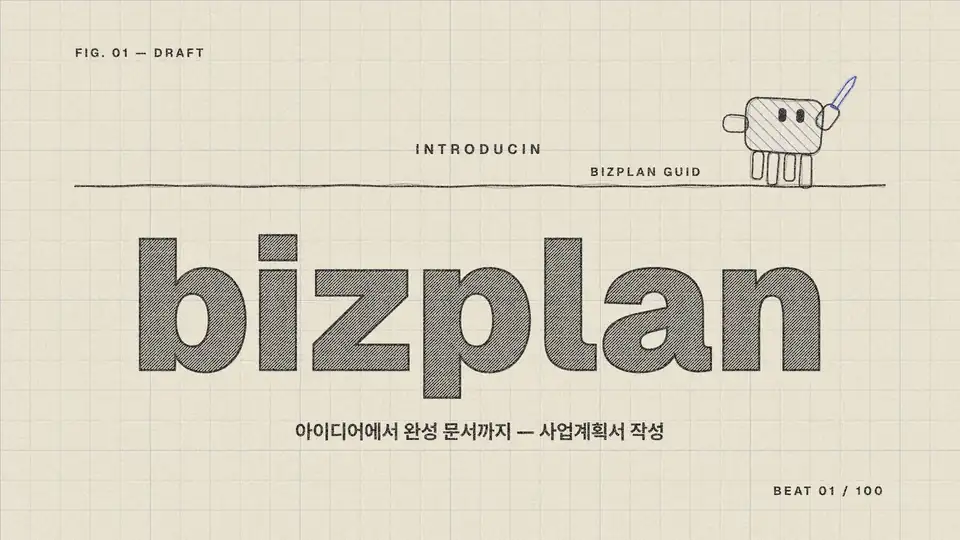
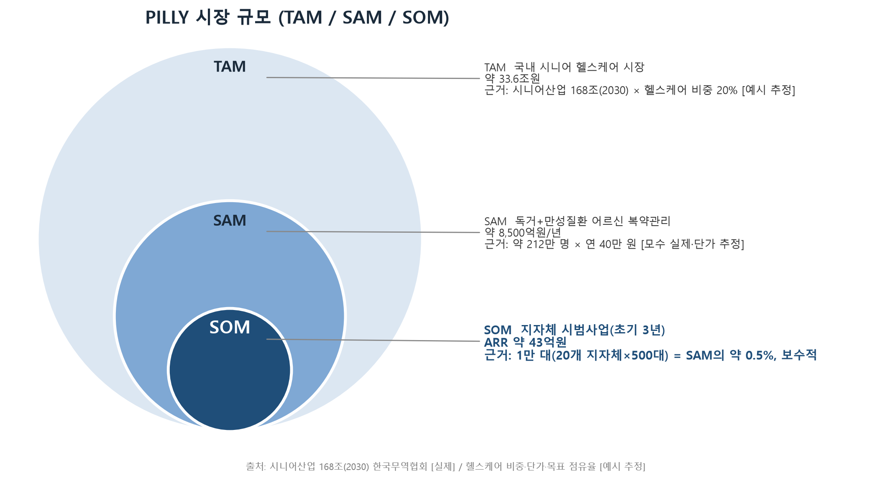
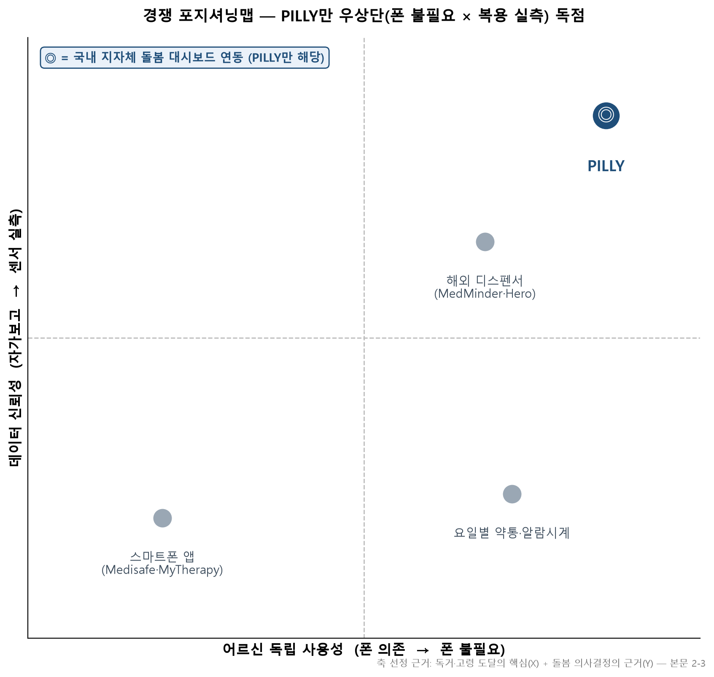

# bizplan — 한국 PSST 사업계획서 스킬

[한국어](README.md) | [English](README.en.md)

<p align="center">
  <a href="https://cdn.jsdelivr.net/gh/jhsoo0211/bussiness-planner-skills@main/docs/motion-graphic/reel/bizplan-reel-web.mp4">
    
  </a>
</p>
<p align="center"><sub>▶ <b>소개 영상 (50초)</b> — 이미지를 누르면 소리가 있는 영상이 브라우저에서 재생됩니다 · <a href="https://github.com/jhsoo0211/bussiness-planner-skills/raw/main/docs/motion-graphic/reel/bizplan-reel.mp4">원본 1080p 내려받기</a></sub></p>

> 한국 정부 창업지원사업의 사업계획서를 **작성·검토·발표 준비**까지 단계별로 돕는 한국어 스킬 18종. Claude Code와 Codex에서 같은 `skills/` 원본을 사용한다.

**한국 사업계획서의 PSST(Problem · Solution · Scale-up · Team) 구조에 맞춰 설계했다.** 문제 인식 → 실현 가능성 → 성장 전략 → 팀 구성의 흐름으로 아이디어를 구체화한다. 범용 글로벌 사업계획서나 해외 투자 IR 전용 템플릿이 아니며, 다른 유형에는 해당 공고·양식·평가 기준에 맞춘 조정이 필요하다.

- 대상 사업: 예비창업패키지, 초기창업패키지, 창업도약패키지, 청년창업사관학교(청창사), U300, 창업중심대학, 재도전성공패키지, 로컬크리에이터, TIPS, 수출바우처 등
- 스킬 본문·기본 안내·예시는 한국어다. **영어 README는 사용 설명의 번역이며, 스킬 전체의 영어 현지화나 해외 지원사업 적합성을 의미하지 않는다.**
- 지원사업마다 양식·금액·기간이 다르므로, 각 스킬은 먼저 **어떤 지원사업·양식 대상인지 확인**하고 예산·기간을 해당 공고 기준으로 조정한다. 공고 확인 전 초안용 기본값은 [공통 규칙](skills/bizplan/references/common-rules.md)의 '기본값과 기준 연도' 절 한 곳에만 둔다.

## 스킬 목록

| 스킬                 | 용도                     | 이럴 때                                                                                                                               |
| -------------------- | ------------------------ | ------------------------------------------------------------------------------------------------------------------------------------- |
| `bizplan`          | 라우터                   | "사업계획서 도와줘"처럼 막연할 때. 상황을 물어 알맞은 모드로 안내                                                                     |
| `bizplan-interview` | 심층 인터뷰              | 작성 전에 블록별로 사실·근거·제약을 묻고 `브리프.md`로 고정 — 이후 모든 모드가 이 파일을 읽어 긴 대화에서 내용이 섞이는 문제를 줄인다 |
| `bizplan-quick`    | 간략 모드                | 5가지(업종·타겟·핵심기능·차별점·약점)만 답하고 PSST 전체 초안을 한 번에                                                                 |
| `bizplan-document` | 완성 문서 모드 | 제출용 완성본 — 깊은 조사, 창업아이템 개요 양식 표부터 4장까지 전체 분량(경어체 서술·주제구·소주제), 시각자료 최대, .docx·.hwpx·.pdf·쪽 미리보기를 한 번에(쪽 수는 줄이지 않고 공고 분량 대비만 보고) |
| `bizplan-item`     | ① 아이템 구체화         | 아이디어만 있음. 아이템명·문제·솔루션·차별점·페르소나 도출                                                                        |
| `bizplan-outline`  | 큰틀 보기                | 본문 전에 대제목→중제목→소제목→한두 줄 요약·증빙 슬롯·배점 비례 분량을 한눈에 확정                                                   |
| `bizplan-problem`  | ② 문제 인식 (P)         | SPIN 기법으로 Pain Point 설득, "배경 및 필요성" 작성                                                                                  |
| `bizplan-research` | ③ 시장·고객·경쟁 조사 | 시장 규모, 타겟 고객·페르소나, 경쟁사 비교 분석                                                                                      |
| `bizplan-solution` | ④ 실현 가능성 (S)       | 기술 구현 계획, 정부 사업비 비목별 예산·자금 조달 계획, 추진 일정표                                                                 |
| `bizplan-growth`   | ⑤ 성장 전략 (S)         | 비즈니스 모델·마케팅, SWOT, BM 구성도, 매출 분해·손익·손익분기점                                                                    |
| `bizplan-team`     | ⑥ 팀 구성 (T)           | 대표자 역량, 팀 현황, 협력 기관                                                                                                       |
| `bizplan-summary`  | ⑦ 개요·마무리          | 개요 요약, 기업명·스토리텔링                                                                                                         |
| `bizplan-visual`   | 시각자료 모드            | 사업계획서에 넣을 그래프·도식·표 구성안 제안 및 제작 지원(matplotlib 그래프, 냅킨AI 인포그래픽 텍스트, 이미지 생성 AI용 영문 프롬프트, 포지셔닝맵·BM구성도 스케치) |
| `bizplan-review`   | ⑧ 심사위원 검토         | 초안 완성 후 점수·강약점·예상 질문, 데이터 신뢰도 검증                                                                              |
| `bizplan-pitch`    | 발표(피칭) 준비          | 발표 슬라이드 구성안, 스토리텔링, 예상 질문·모범 답변                                                                                |
| `bizplan-slides`   | 발표 슬라이드 제작       | 내용을 정보 유형별 구조(카드·KPI·TAM·비교·간트 등)로 파싱해 배치 → PPT 템플릿은 디자인 그대로 채우고, PDF·이미지 템플릿이나 템플릿이 없으면 테마로 편집 가능한 PPTX를 새로 그림(PDF 함께) + 누락·넘침·원문 수치 대조 검증 |
| `bizplan-export`   | 수출바우처               | 수출바우처 종합 구성, 목표시장 분석                                                                                                   |
| `bizplan-analyze`  | 벤치마킹 분석            | 남의 계획서·합격 사례 비교 분석, 작성 공식 도출                                                                                      |

## 설치 방법

### ① 채팅으로 설치 (가장 쉬움)

Claude Code나 Codex 채팅창에 저장소 링크를 붙여넣고 설치를 부탁한다. 에이전트가 저장소를 내려받아 아래 ②·③의 설치 스크립트를 대신 실행한다.

```text
https://github.com/jhsoo0211/bussiness-planner-skills 이 스킬 설치해줘
```

더 확실하게 하려면 설치 방법까지 적어 준다:

```text
https://github.com/jhsoo0211/bussiness-planner-skills 를 내려받아 scripts/install_skills.py 로 bizplan 스킬을 설치해줘
```

- 설치 위치: Claude Code는 `~/.claude/skills/`, Codex는 `~/.agents/skills/`. 에이전트가 명령 실행 허락을 물으면 내용을 확인하고 승인한다.
- 설치가 끝나면 새 세션을 열거나 재시작한 뒤 `/bizplan`(Claude Code) 또는 `$bizplan`(Codex)으로 시작한다.
- 에이전트가 설치하지 못하거나 다른 위치에 설치하려 하면 ②·③의 명령을 직접 실행한다.

### ② Codex에 설치 (터미널)

Git과 Python 3가 필요하다. 먼저 이 저장소를 내려받고 저장소 폴더로 이동한다. Windows에서 `python` 대신 `py`를 사용하는 환경이면 아래 명령의 `python`을 `py`로 바꾼다.

```bash
git clone https://github.com/jhsoo0211/bussiness-planner-skills.git
cd bussiness-planner-skills
python scripts/install_skills.py --agent codex
```

18개 스킬과 하위 참조 문서·스크립트를 `~/.agents/skills/`에 설치한다. 하나라도 같은 이름이 이미 있으면 **아무것도 덮어쓰지 않고 중단**한다. 기존 설치를 업데이트할 때는 사용자 수정본을 먼저 백업하고 대상 폴더를 비운 뒤 다시 실행한다. 여러 위치에 중복 설치하지 않는다.

특정 프로젝트에서만 쓰려면 목적지를 지정한다:

```bash
python scripts/install_skills.py --agent codex --dest /path/to/project/.agents/skills
```

```powershell
# Windows PowerShell
python scripts/install_skills.py --agent codex --dest 'C:\Projects\my-project\.agents\skills'
```

새 턴/세션에서 `bizplan` 스킬을 선택하거나 다음처럼 요청한다. Codex CLI/IDE에서는 `/skills` 또는 `$`로 스킬을 찾을 수 있다. 보이지 않으면 Codex를 재시작한다. [공식 스킬 문서](https://learn.chatgpt.com/docs/build-skills)

```text
$bizplan 예비창업패키지 사업계획서를 쓰고 싶어. 공고문을 먼저 확인해줘.
$bizplan-problem 제공한 메모의 문제 우선순위를 유지해 문제 인식 파트를 써줘.
$bizplan-growth 제공한 근거와 제약을 반영해 성장 전략 파트를 써줘.
$bizplan-review 이 초안을 제공한 배점표로 검토해줘.
```

특정 파트를 정했다면 라우터를 거치지 않고 해당 스킬을 직접 지정할 수 있다. 이름을 지정하지 않는 자연어 요청에서는 Codex가 설명에 맞는 스킬을 선택한다. **직접 지정과 자동 선택은 별도로 검증**하며, 스킬을 불렀다는 사실만으로 모든 파트·참고문서를 적용했다고 보지 않는다.

설치본에 `bizplan/references/common-rules.md`가 포함됐는지 확인한다. 세부 스킬도 이 공통 문서를 참조하므로 18개를 함께 설치하는 것을 권장한다. Codex용 별도 프롬프트 복사본이나 영구 분기 없이 같은 스킬을 유지한다.

### ③ Claude Code에 설치 (터미널)

위와 같이 저장소를 내려받은 뒤 실행하면 `~/.claude/skills/`에 설치한다:

```bash
python scripts/install_skills.py --agent claude
```

이 로컬 설치에서는 `/bizplan` 또는 자연어로 요청한다. 특정 파트는 다음처럼 직접 지정한다. 스킬이 보이지 않으면 Claude Code를 재시작한다.

```text
/bizplan-problem 제공한 메모의 문제 우선순위를 유지해 문제 인식 파트를 써줘.
/bizplan-growth 제공한 근거와 제약을 반영해 성장 전략 파트를 써줘.
```

기존 Claude Code 마켓플레이스 설치도 사용할 수 있다:

```text
/plugin marketplace add jhsoo0211/bussiness-planner-skills
/plugin install bizplan@business-planner-skills
```

플러그인 이름은 `bizplan`이므로 플러그인 설치에서는 `/bizplan:bizplan-problem`, `/bizplan:bizplan-growth`, `/bizplan:bizplan-review`처럼 namespace를 포함해 지정한다. Claude Code도 직접 호출과 자동 선택을 모두 지원한다. [Claude Code 공식 스킬 문서](https://code.claude.com/docs/en/skills)

이 `/plugin` 명령은 **Claude Code용**이다. Codex에서는 위의 로컬 설치 절차를 사용한다. 마켓플레이스 업데이트는 Claude Code의 `/plugin marketplace update`를 사용한다.

**Claude.ai 일반 채팅은 별도 환경이다.** 공식 도움말은 Customize → Skills에서 활성화하고, 필요하면 사용할 스킬 이름을 요청에 명시하도록 안내한다. 이 저장소의 Claude Code 설치·slash 명령을 그대로 적용할 수 있다는 뜻은 아니다. [Claude.ai 공식 스킬 도움말](https://support.claude.com/en/articles/12512180-use-skills-in-claude)

### 저자 인사이트와 파트별 작성

각 파트와 `bizplan-quick`은 **[파트별 저자 인사이트 지도](skills/bizplan/references/author-insights.md)에 연결된 필수 원문을 작성 전에 읽고**, 해당 파트의 작성 기준에 적용해야 한다. 검토 단계까지 미루거나 공통 규칙만 읽은 것으로 대신하지 않는다. 사용자가 제공한 메모의 문제 우선순위·기술·비용·안전 제약은 양식의 해당 항목에 연결하고, 사례에서 얻은 작성 원칙과 현재 팀의 검증된 사실은 구분한다.

검증에서는 **참고문서를 읽은 기록**과 **본문에 실제 적용한 근거**를 따로 확인한다. 필수 참조 연결을 추가했다는 사실만으로 검증 완료를 주장하지 않는다. 이전 U300 실행은 Codex에서 자동으로 quick 경로를 선택한 1회 작성 사례이며 Claude 성능 비교가 아니다. 변경 후의 제한된 명시 호출 검사는 [가상 입력과 결과](evals/author-insights/README.md)에 기록한다. 전체 작성 흐름·Claude 비교·원본 문서의 페이지 검증은 별도다. [평가 절차와 증거 범위](evals/README.md)

### 도구와 검증 범위

- 기본 작성·검토 지침은 Markdown 스킬이며 별도의 API 키를 포함하지 않는다. 실행할 Claude Code 또는 Codex 계정·환경은 사용자가 준비한다.
- 웹 조사, 시각자료 렌더(Node + Playwright, 없으면 Python 그래프), 문서 변환, 슬라이드 렌더 검수는 해당 환경의 도구·권한이 있을 때 수행한다. 설치만으로 외부 도구나 서비스를 추가하지 않는다. 스크립트별 필요 도구는 아래 '포함된 스크립트' 표.
- 도구가 없으면 수행하지 못한 작업과 필요한 자료를 밝힌다. 확인하지 못한 통계·출처·팀 실적을 검증 완료로 쓰지 않는다.
- `dist/*v0.4.0.zip`은 기존 배포 파일이다. 이번 Codex 안내와 변경을 사용하려면 이 저장소의 현재 체크아웃으로 설치한다.

```bash
python scripts/check_installation.py
```

위 명령은 임시 폴더에서 18개 스킬·리소스 복사와 덮어쓰기 방지를 확인한다. 모델을 실행하지 않으며 **Codex와 Claude의 작성 품질·속도·비용을 비교한 결과가 아니다**. 실제 평가 절차와 기록 기준은 [evals/README.md](evals/README.md)를 참고한다.

## 포함된 스크립트

스킬 폴더의 `scripts/`에 있다. 모델이 지침에 따라 실행하며, 직접 써도 된다(`python3 -B <스크립트> --help`).

| 스크립트 | 하는 일 | 필요 도구 |
|----------|---------|-----------|
| `bizplan/scripts/read_form.py` | 공고·제출 양식(.hwp/.hwpx/.docx/.pdf)에서 목차·안내 문구·분량 지시·표 추출 | python-hwpx(.hwp), pdftotext(.pdf) |
| `bizplan/scripts/check_tables.py` | 합계·비율 100%·곱셈식 검산, `=SUM` 수식 검산표 .xlsx | openpyxl(.xlsx) |
| `bizplan/scripts/md_to_docx.py` | .md → A4·맑은 고딕·표 테두리 .docx (`--gov-bullets`로 □○-·). 그림 앞 헤드라인·표 제목을 같은 쪽에 묶고, 표 행이 쪽에서 갈라지지 않게, 열 너비는 낱말이 끊기지 않게 정한다. 그림 alt 캡션은 `--captions`일 때만. `--style form`은 완성 문서 서식(제목 상자·장 띠·주제구 밑줄·개요 양식 표·연노랑 머리행·쪽 번호) | python-docx, pandoc(선택) |
| `bizplan/scripts/md_to_hwpx.py` | .md → 한글 .hwpx/.hwp (개조식·표·그림) + 구조 검증. `--style form`은 완성 문서 서식 | python-hwpx |
| `bizplan/scripts/build_document.py` | 완성본 한 번에: 검산 → 그림 `--print` → .docx → .pdf → 쪽 미리보기 → .hwpx, 쪽 수(공고 분량 대비)·그림 수·남은 사진 자리 보고 | 위 변환기 + LibreOffice·pdftoppm(있으면) |
| `bizplan/scripts/guide_draft.py` | 사업계획서 목차 순서대로 '작성 가이드'(별도 산출물) 골격 — 작성법·섹션 설계도 항목 판정, 주장형 헤드라인·시각자료 수, 숫자 등록부(`--brief`), 미확보 표기·검토 점수 영향·넣어 줄 자산 | — |
| `bizplan/scripts/find_tools.py` | 이 환경에 설치된 스킬을 읽어 도구 지도(`tool-map.md`)의 작업별로 지금 쓸 수 있는 스킬과 대안을 보여 준다 | — |
| `bizplan-visual/scripts/html_visuals.py` | 시각자료 spec(JSON) → HTML(인라인 SVG) + PNG. 결론 제목 · 그래서 한 줄 · 출처 틀로 사업계획서 목차별 33종(TAM·세분 시장·페르소나·설문·인용·구성비·추이·문제→해결·사진 격자·화면 ①②③·흐름도·비교표·포지셔닝·벤·막대·전후·BM 구조도·BMC·단위 경제성·채널별 매출·사업비·손익·월별 매출·3지표·퍼널·간트·로드맵·계단·연혁·SWOT·팀·협력 단계·표), 문서용 인쇄 크기(`--print`, A4 본문 폭에서 가장 작은 글자 7.4pt 이상)·발표용 16:9(`--slide`, 넘치면 맞춤)·테마 색(`--theme`), 합계·성장률·손익 불일치 경고 | Node + Playwright(PNG), 한글 글꼴 |
| `bizplan-visual/scripts/chart_templates.py` | (대체 경로) matplotlib 차트 — 시장 추이·비교·TAM/SAM/SOM·포지셔닝맵·간트·퍼널·손익 콤보(200dpi, 출처 캡션) | matplotlib, 한글 폰트 |
| `bizplan-slides/scripts/pptx_inspect.py` | 발표 템플릿의 레이아웃·자리표시자·샘플 슬라이드·테마 분석 | python-pptx |
| `bizplan-slides/scripts/pptx_build.py` | 템플릿 디자인을 유지한 채 스펙(JSON)대로 PPTX 생성 | python-pptx, Pillow |
| `bizplan-slides/scripts/export_pdf.py` | PPTX/DOCX → PDF(LibreOffice), HTML 슬라이드 → PDF(Playwright) | LibreOffice / Node+Playwright |
| `bizplan-slides/scripts/preview.py` | PDF를 장별 PNG·모아보기로 렌더 | pdftoppm, Pillow |
| `bizplan-slides/scripts/make_basic_template.py` | 기본 16:9 한국어 템플릿 재생성 | python-pptx |
| `bizplan-slides/scripts/suggest_patterns.py` | 사업계획서 .md → 정보 단위·관계 유형·추천 패턴·스펙 초안(파싱표), 발표 구성안 장과 짝짓기 | — |
| `bizplan-slides/scripts/theme_deck.py` | 내용 스펙(JSON) → 테마 디자인의 편집 가능한 PPTX(패턴 23종·네이티브 차트), 스펙 검사·누락 대조 | python-pptx, Pillow |
| `bizplan-slides/scripts/deck_check.py` | 발표 PPTX의 수치·날짜(차트 값 포함)를 원문과 대조, 미확보 표기·작은 글자 집계 | python-pptx |
| `bizplan-slides/scripts/theme_from_pdf.py` | 그림 템플릿(PDF·PNG)에서 쪽 이미지·모아보기·색 후보·시작용 테마 JSON 추출 | pdftoppm, Pillow |
| `bizplan-slides/scripts/design_advisor.py` | 기존 파싱 결과에 디자인만 추천 — 아이템·고객·톤·브랜드 → 테마·단위별 표현·미리캔버스 참고 식별자. 원문·관계·패턴·덱 보존 | Python 표준 라이브러리 |

## 섹션 설계도 · 조사노트 · 도구 지도

- **[섹션 설계도](skills/bizplan/references/section-blueprints.md)**: 사업계획서를 블록 14개(한 줄 소개·개요·배경·문제·시장·준비 정도·구체화·차별·사업비·BM·진입·매출·투자·고용·로드맵·팀)로 쓰는 기준이다.
  - 블록 문법: 소제목은 `○ [태그] 결론 문장` → 증명하는 시각자료 → 근거 2~4줄 → 출처·별첨.
  - 숫자 등록부: 핵심 숫자 6~10개를 브리프에 먼저 적고, 본문·개요·그림·발표가 같은 값을 쓴다.
  - 근거 수준 라벨(확인·산출·관찰·가정), 보수 추정(의향·전환율은 조사값의 절반), 검산 상자.
  - 양식 매핑: 같은 블록을 예비창업패키지(최근형·세분형)·U300+·온라인 문항형(모두의 창업 등) 목차에 배치한다. 문체도 양식별로 자동이다(문서형은 헤드라인 + 개조식, 문항형은 ◆ 소제목 + 짧은 서술).
- **조사노트** `조사노트.md`(`bizplan-research`): 하위 질문 → 출처 표(근거 수준·판정·확인 경로) → 1차 고객 수 산식 → 인터뷰 종합 → 경쟁 비교·요약 카드 → 숫자 등록부 후보 → 블록별 문장 초안 → 빈칸 계획.
- **[HTML 시각자료](skills/bizplan-visual/references/visual-html.md)**: 그림마다 결론 제목(무엇을 말하는가) → 그림 → 그래서 한 줄 → 출처 · 시점 · 표본. 우리만 강조색, 나머지는 회색, 축은 하나, 미확보 값은 `○○` 점선으로 보인다. [목차별 시각자료 지도](skills/bizplan-visual/references/visual-html.md)가 절마다 쓸 그림을 정하고, BM 구조도는 누가 누구와 무엇을 주고받는가(사용료 ↔ 서비스·데이터·장비)를 결제자 표시와 함께 그린다(금액은 매출 산식에). `html_visuals.py --sample 예시.json`으로 목차순 예시 34개를 만든다.
- **[도구 지도](skills/bizplan/references/tool-map.md)**: 웹 조사·인터뷰 종합·데이터 검증·차트·재무 표·규제 확인·문서 편집 같은 작업마다 '환경에 있으면 부를 스킬 / 넘길 것 / 받을 것 / 없으면 내장 절차'를 한 표에 둔다. 모든 스킬이 이 한 곳만 본다. `find_tools.py`로 지금 쓸 수 있는 것을 확인한다.

## 초안과 함께 받는 코칭

초안만 주지 않고 "여기서 무엇을 고려하고 무엇을 더 적어야 하는지"를 함께 준다(기준: [작성 코칭](skills/bizplan/references/coaching.md)).

- **채팅 작성 팁**: 섹션마다 3~4줄로 준다. 내용은 PSST 작성법의 그 절 기준, 이 초안에서 디벨롭할 곳, 다음 행동이다.
- **작성 가이드** `작성가이드.md`: 사업계획서와 **따로 보는 산출물**이다. 사업계획서 목차 순서대로 "그 부분은 ~를 고려해야 한다 / ~를 적어야 한다"를 정리한다.
  - 목차마다: 지금 상태(작성법 ✓·△·✗) · 고려해야 할 점 · 꼭 적어야 할 것(체크 항목) · 이렇게 써 보세요(사실 확인 후 쓸 문장) · 발표에서는 · 근거 확보 · **있으면 넣어 주세요**(인터뷰 메모·견적서·LOI 같은 자산)
  - 맨 앞 '한눈에': 점수가 가장 많이 오르는 행동 3개와 모아 주실 자료 / 맨 끝: 제출 전 체크리스트
  - 사업계획서 본문에는 아무것도 끼우지 않는다. 제출본은 `사업계획서.md`다.

## 정보를 어떤 구조로 보여줄지 (파싱 기준)

사업계획서 내용을 표·그림·슬라이드로 옮길 때는 주제가 아니라 **정보 사이의 관계**로 형식을 고른다. 23개 유형이 있다(병렬·병렬→결론·중심-주변·핵심 수치·추이·구성비·시장 포함·기준별 대조·전→후·2축 위치·단계·이정표·과업×기간·예산 표·SWOT·라벨-내용 쌍·체계·팀 등).

- [정보 유형 → 시각화 구조](skills/bizplan-visual/references/info-patterns.md): 원문 신호, 결정 순서, 슬라이드 패턴·문서 표현, 수용량, 흔한 실수. 문서(`bizplan-visual`)와 발표(`bizplan-slides`)가 같이 쓴다.
- [발표 구성 청사진](skills/bizplan-slides/references/blueprints.md): 사용자 제공 템플릿 3종(필수 구성 제안서 30장 · 연간 사업계획 20장 · 기본 15장)을 장마다 '전달하는 정보 → 형식 → 패턴'으로 분석했다. 공통 형식 문법 10가지와 PSST 발표 대응표가 들어 있다.

### 파싱 결과에 어떤 디자인을 적용할지

논리 구조와 디자인 선택은 분리한다. 기존 파서가 정한 관계·패턴과 PSST 흐름을 유지한 채, [디자인 분류 지침](skills/bizplan-visual/references/design-selection.md)으로 아이템·고객·브랜드에 맞는 색·구획·여백·강조만 고른다. `design_advisor.py`는 별도 추천표와 선택 테마를 만들며 원문·`단위.json`·`deck.json`을 수정하지 않는다.

미리캔버스 **90개 후보의 모아보기 조사 기록과 30개 패턴 매핑**을 [참고집](skills/bizplan-visual/assets/design-references.json)에 정리했다. 원본 PPT·PDF·이미지·문구·로고는 포함하지 않았다. 기존 3개 테마에 민트·샌드·플럼·라임을 더해 7개 후보를 제공한다. 업종별 색상은 고정하지 않으며 지정 양식과 사용자 브랜드가 우선이다.

## 자료 넣는 법 (템플릿 · 사업계획서 자료)

이 저장소는 **공개**다. 공개해도 되는 것만 커밋하고, 나머지는 비공개 위치에 둔다.

| 자료 | 넣는 곳 | 커밋 |
|------|---------|------|
| 재배포해도 되는 발표 템플릿(.pptx/.potx) | `skills/bizplan-slides/assets/templates/` + 같은 이름의 `.md` 설명 | 예 |
| 학교·기관 지정 양식, 유료 템플릿, 로고·실명이 든 템플릿 | `skills/bizplan-slides/assets/templates/local/` | 아니오(gitignore, 로컬 설치본에서만 사용) |
| 그림만 든 템플릿(PDF·PNG) 원본 | `skills/bizplan-slides/assets/templates/local/` + 같은 이름 `.md`(구조 메모) | 아니오 |
| 그림 템플릿에서 뽑은 테마(색·형식) | 공개 가능하면 `skills/bizplan-slides/assets/themes/`, 아니면 `assets/themes/local/` | 공개분만 |
| 합격·수상 사업계획서 원문(PDF·HWP) | `자료/` 또는 비공개 저장소 | 아니오(gitignore) |
| 원문에서 뽑은 작성 패턴 | `skills/bizplan/references/award-patterns.md` | 예(익명화) |
| 원문에서 뽑은 검토 교훈 | `skills/bizplan-review/references/cases/<분야>.md` | 예(익명화) |

- 템플릿을 넣으면 `python3 -B skills/bizplan-slides/scripts/pptx_inspect.py <파일>`로 경고(4:3 잔재·레이아웃 없음·한글 글꼴)를 먼저 확인한다. 자세한 규칙은 [템플릿 폴더 안내](skills/bizplan-slides/assets/templates/README.md).
- PDF·이미지 템플릿은 글상자가 없어 그대로 채울 수 없다. `theme_from_pdf.py`로 색을 뽑아 테마를 만들고, 장 구성은 [발표 구성 청사진](skills/bizplan-slides/references/blueprints.md) 형식으로 적는다. 들어 있는 테마 7종과 생성 방법은 [테마 안내](skills/bizplan-slides/assets/themes/README.md)에 있다.
- 사업계획서 원문은 `bizplan-analyze`로 분석하면 패턴·교훈을 위 파일들에 익명으로 옮기는 추가안을 만들어 준다.
- `.pptx`·`.pdf`·`.hwp` 같은 바이너리는 `.gitattributes`가 줄바꿈 변환에서 보호한다.

## 저장소 규칙 (ruleset · 기밀 차단 검사)

main 브랜치는 PR로만 바꾸고, PR마다 자동 검사 두 개가 통과해야 병합된다.

| 검사 | 하는 일 |
|------|---------|
| `install-check` | 스크립트 문법, JSON 파싱, `scripts/check_installation.py`, 디자인 분류 회귀 검사 `scripts/check_design_advisor.py` |
| `confidential-guard` | `scripts/check_confidential.py` — 비공개 폴더(`자료/`·`분석/`·`templates/local/`·`themes/local/`), 원문 형식(.pdf·.hwp·.hwpx·.doc·.docx·.xlsx·.ppt), `dist/` 밖 zip, 비공개 용어 |

처음 한 번 설정한다.

1. 이 검사가 들어 있는 브랜치를 main에 병합한다. 작업 브랜치에 merge 커밋이 있으면 **Squash and merge**를 쓴다(선형 이력 규칙).
2. Settings → Rules → Rulesets → New ruleset ▾ → **Import a ruleset** → `.github/rulesets/main.json`, 이어서 `tags.json`.
   - `main.json`: PR 필수(승인 0명), 강제 푸시·삭제 차단, 선형 이력, 검사 2개 필수. 저장소 관리자는 긴급 시 우회할 수 있다.
   - `tags.json`: `v*` 태그 삭제·이동 금지.
   - 가져오기에서 `allowed_merge_methods`가 거부되면 그 줄을 지우고 다시 가져온다.
3. Settings → Secrets and variables → Actions → New repository secret → 이름 `CONFIDENTIAL_TERMS`, 값은 저장소에 들어가면 안 되는 용어(팀명·아이템명·실명 등)를 한 줄에 하나씩.
   - 검사 로그에는 경로·줄 번호·사유만 나오고 용어 자체는 나오지 않는다. 경로에 용어가 있으면 그 부분을 `***`로 가린다.

커밋 전에 로컬에서 같은 검사를 돌릴 수 있다. 용어 파일은 `~/.config/bizplan/confidential-terms.txt`에 두면 자동으로 읽는다.

```bash
python3 scripts/check_confidential.py [--terms 용어파일]
```

## 빠른 시작 (스텝 바이 스텝)

**Step 1.** Claude Code 또는 Codex에 이렇게 말한다 (공고문 파일이 있으면 함께 첨부):

> 예비창업패키지 사업계획서 쓰고 싶어. 아이템은 시니어용 복약관리 약통이야.

**Step 2.** 라우터(`bizplan`)가 시작 질문을 한다:

- 어떤 지원사업·공모전인지 (평가 기준표/배점표가 있으면 첨부 요청)
- 진행 단계 — 아이디어만 / 특정 섹션 작성 중 / 초안 완성
- **빠른 버전**(전체 초안 한 번에) vs **꼼꼼 버전**(조사 포함 단계별, 오래 걸림) vs **완성 문서**(제출용 완성본 + 그림 + docx·hwpx·pdf까지) vs 특정 섹션만
- 출력 형식 — 채팅만 / .md 파일 저장 / .docx / .hwpx(한글) (세션에서 한 번만 정한다)

> 질문에 답하기 어려우면 아이디어 메모·파일만 던져도 된다 — 스킬이 기획 요약 초안을 먼저 만들어 "이런 기획이 맞나요?"라고 확인받고 시작한다.

**Step 2-1. 심층 인터뷰.** 본문을 쓰기 전에 `bizplan-interview`가 블록별(지원사업·고객·문제·솔루션·시장·실행 증거·BM·재무·팀·일정·제약)로 묻고 답을 `브리프.md`에 바로 적는다. 채팅으로 답하거나, 질문지(브리프 양식)를 받아 한 번에 채워 보내도 된다. 빠른 버전은 필수 문항 20개 안팎, 꼼꼼 버전은 50~60개다. 이후 단계는 이 브리프만 읽고 작업하므로, 단계마다 새 대화로 시작해도(브리프 첨부) 내용이 섞이지 않는다.

**Step 3.** 선택한 모드가 실행된다. 예를 들어 빠른 버전이면 `bizplan-quick`이 5가지(업종·타겟·핵심기능·차별점·단점)만 묻고 PSST 전체 초안 + 문제-솔루션 1:1 자체 점검표를 만든다.

**Step 4.** 초안이 나오면 검토를 돌린다:

> 심사위원처럼 점수 매기고 피드백해줘

`bizplan-review`가 배점 항목별 득점표, 11대 체크포인트(O/△/X), 약점별 "더 나은 방향", 데이터 신뢰도 검증, 예상 질문까지 제공한다. 출력 예시: [examples/예시-검토리포트-PILLY.md](examples/예시-검토리포트-PILLY.md)

**Step 5.** 발표 심사가 있으면:

> 발표 준비해줘. 발표 7분 + 질의응답 10분이야.

`bizplan-pitch`가 발표 흐름(대회 성격별 조정) → 슬라이드 구성안(슬라이드별 유도 질문 포함) → 장점 30초 답변·약점 방어 → 예상 질문을 만든다.

**Step 6.** 발표자료 파일이 필요하면:

> 학교 템플릿(첨부한 pptx)에 넣어서 PPT랑 PDF로 뽑아줘.

`bizplan-slides`는 먼저 사업계획서를 정보 단위로 파싱해 장마다 형식(카드·수치·시장 규모·비교·간트 등)을 정한 매핑표를 보여준다. 그다음 템플릿 디자인(마스터·색·바닥글)을 유지한 채 내용을 채워 `발표.pptx`·`발표.pdf`와 장별 미리보기를 만들고, 슬라이드 숫자를 원문과 대조한다.

> 이 PDF 템플릿 느낌으로 만들어줘. (또는) 템플릿 없이 깔끔하게.

PDF·이미지 템플릿이나 템플릿이 없으면 아이템·고객·브랜드에 맞는 [테마](skills/bizplan-slides/assets/themes/README.md)로 편집 가능한 PPTX를 새로 그린다. 기존 구조는 유지하고 디자인 적용만 별도로 분류한다.

## 한 줄 사용 예시

- "예비창업패키지 사업계획서 쓰고 싶은데 뭐부터 해야 할지 모르겠어" → `bizplan`(라우터)
- "AI 반려동물 건강관리 앱 아이디어를 구체화해줘" → `bizplan-item`
- "문제 인식 파트를 심사위원이 납득하게 써줘" → `bizplan-problem`
- "이 시장 규모랑 경쟁사 좀 조사해줘" → `bizplan-research`
- "예산 계획이랑 8개월 추진 일정 만들어줘" → `bizplan-solution`
- "TAM SAM SOM 도식이랑 시장 그래프 만들어줘" → `bizplan-visual`
- "초안 다 썼는데 심사위원처럼 점수 매기고 피드백해줘" → `bizplan-review`
- "발표 슬라이드랑 예상 질문 준비해줘" → `bizplan-pitch`
- "이 템플릿에 넣어서 피피티로 뽑아줘" → `bizplan-slides`
- "본문 쓰기 전에 목차랑 요약부터 잡아줘" → `bizplan-outline`
- "빠르게 전체 초안부터 뽑아줘" → `bizplan-quick`
- "쓰기 전에 내 상황부터 꼼꼼하게 물어봐줘" → `bizplan-interview`

## 산출물 미리보기

`bizplan-visual`이 실제로 생성하는 시각자료 (가상 아이템 PILLY 예시, 재현 스크립트는 [examples/visuals/](examples/visuals/)):

| TAM/SAM/SOM 동심원                                     | 경쟁 포지셔닝맵                                       |
| ------------------------------------------------------ | ----------------------------------------------------- |
|  |  |

완성 예시 전문:

- **PILLY** (AI 복약관리 스마트 약통 — 스킬이 직접 작성→검토): [제작 예시](examples/예시-사업계획서-PILLY.md) · [검토 리포트](examples/예시-검토리포트-PILLY.md)
- **Re:Shell** (굴 패각 제설제 — 외부 작성 계획서를 검토): [사업계획서 예시](examples/예시-사업계획서-리쉘-굴패각제설제.md) · [검토 리포트](examples/예시-검토리포트-리쉘-굴패각제설제.md)

## 참고 문서

- `docs/psst.md` — 25개 원본 프롬프트를 모드별로 재구성한 마스터 문서
- `skills/bizplan-review/references/rubrics.md` — 사업별 공식 평가표 모음(예창패·초창패·창업도약·모두의 창업·청창사·U300·창업중심대학·재도전·로컬·TIPS, 2026 공고 기준). 평가 단계·항목·과락·가점·분량·블라인드 규정과 확인 수준을 적었다. 2026-10 조사 때 공고 원문 파일은 받지 못해 **검색 색인 발췌 기준 잠정값**이며, 배점 숫자는 대부분 공고에 없거나 확인되지 않았다 — 공고 원문을 첨부하면 그것이 우선한다
- `examples/` — 가상 아이템 2종의 완성 예시. **PILLY**(AI 복약관리 약통)는 스킬 파이프라인으로 작성→검토한 예시(문제-솔루션 1:1 대응표·TAM/SAM/SOM 산정·시각자료 구성안·자체 채점 포함). **Re:Shell**(굴 패각 제설제)은 외부에서 작성된 U300 초안을 `bizplan-review`로 평가한 예시(배점 득점표·11대 체크포인트·심사위원 납득도·데이터 검산 포함). 모두 데모용 가상 콘텐츠

## 유의사항

- 정부지원사업 외 문서(투자 IR·민간 공모전·정책자금·B2B 제안 등)는 해당 심사 자료·양식에 맞춰 조정한 뒤 보조 도구로 활용한다. 기본 PSST 구성을 그대로 적용하면 맞지 않을 수 있다.
- 공식 평가 기준표(배점표)가 있으면 스킬에 첨부하라 — 배점 항목에 본문을 매핑해 검토·작성한다. 없으면 `rubrics.md`의 해당 사업 평가표를 확인 수준과 함께 쓴다.
- 개인정보(학교명·직장명)는 ○○로 가린다(예: ○○대학교 ○○학과). 'S대'처럼 기관을 연상시키는 이니셜은 쓰지 않는다. 단, **제출 양식이 소속·실명 기재를 공식 요구하는 칸**(예: 학생창업 트랙의 소속대학)은 양식을 따른다.
- AI가 생성한 시장 데이터·통계는 **반드시 원출처로 검증**한 뒤 제출한다.
- 비현실적인 예산·일정은 지양한다.
- 출력 형식(채팅/.md/.docx/.hwpx)은 라우터가 세션 시작 때 한 번 묻는다. 웹/앱에서는 섹션별로 파일에 누적하고 채팅에는 요약만 보여준다. 변환본은 A4·한글 글꼴·표 테두리 서식으로 만들며, .hwpx는 한컴오피스에서 한 번 열어 확인한다.
- U300 등 학생 트랙은 라우터가 깊이 인터뷰(원가·시제품·실적·재무 근거 보유 여부)를 먼저 한다 — 증빙이 있는 항목만 예창패 수준 깊이로 쓰고, 없는 항목은 "산정 예정(근거·확보 시점 명시)"로 처리한다.
